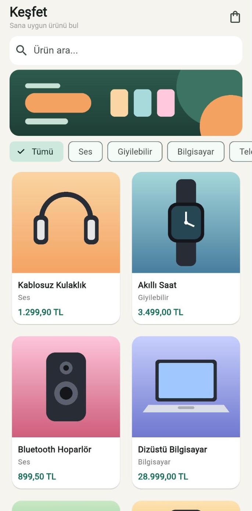
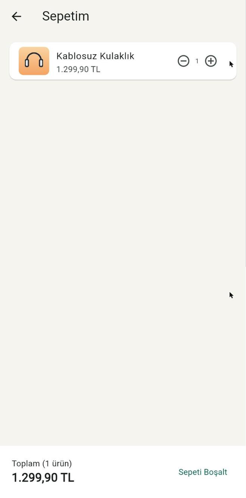

# Mini Katalog Uygulaması

Flutter ile geliştirilmiş basit bir ürün kataloğu uygulamasıdır. Ürünler bir JSON dosyasından okunur, ana sayfada kart yapısında listelenir, ürüne dokunulduğunda detay sayfası açılır ve ürün sepete eklenebilir.

## Özellikler

- Ana sayfa: banner, arama kutusu, kategori filtresi ve `GridView` ile ürün kartları
- Ürün detay sayfası: görsel, fiyat, puan ve açıklama
- Sepet (simülasyon): ürün ekleme, adet artırma / azaltma, toplam tutar
- Sayfa geçişleri: `Navigator` ve Named Routes
- Sayfalar arası veri taşıma: Route Arguments
- Veri modeli: `Product` sınıfı, `fromJson` / `toJson`
- Asset yönetimi: `assets/products.json` ve `assets/images/`
- Ek paket kullanılmamıştır (yalnızca `material.dart`)

## Kullanılan Flutter Sürümü

- Flutter 3.24.5 (stable)
- Dart 3.5

## Klasör Yapısı

```
mini_katalog/
├── lib/
│   ├── main.dart                     # Uygulama girişi, tema ve route tanımları
│   ├── models/product.dart           # Ürün modeli (fromJson / toJson)
│   ├── services/product_service.dart # JSON dosyasından ürünleri okur
│   ├── state/cart.dart               # Sepet durumu (ChangeNotifier)
│   ├── screens/
│   │   ├── home_screen.dart          # Ana sayfa ve ürün listesi
│   │   ├── product_detail_screen.dart# Ürün detayı
│   │   └── cart_screen.dart          # Sepet
│   ├── widgets/                      # ProductCard, CartIconButton
│   └── utils/formatters.dart         # Fiyat biçimlendirme
├── assets/
│   ├── products.json                 # Ürün verileri
│   └── images/                       # Ürün ve banner görselleri
├── screenshots/                      # Ekran görüntüleri
└── pubspec.yaml
```

## Çalıştırma Adımları

1. Flutter SDK'nın kurulu olduğunu doğrulayın:
   ```bash
   flutter --version
   ```
2. Projeyi indirin:
   ```bash
   git clone https://github.com/ozcpr/mini_katalog.git
   cd mini_katalog
   ```
3. Platform klasörleri (android, ios, web) yoksa oluşturun:
   ```bash
   flutter create .
   ```
4. Paketleri yükleyin:
   ```bash
   flutter pub get
   ```
5. Bir emülatör açın ya da cihaz bağlayın ve uygulamayı çalıştırın:
   ```bash
   flutter run
   ```
   Tarayıcıda çalıştırmak için: `flutter run -d chrome`

## Ekran Görüntüleri

| Ana Sayfa / Ürün Listesi | Ürün Detayı | Sepet |
|---|---|---|
|  |  |  |

## Veri Kaynağı

Ürün verileri ve görseller eğitim ve demo amaçlıdır; gerçek bir e-ticaret altyapısını temsil etmez. Veriler `assets/products.json` dosyasında tutulur ve bir API yanıtı gibi model sınıfına dönüştürülür.

## Hazırlayan

Ozan Kısrık – Software Persona Mobil Uygulama Geliştirme Eğitimi, 2026
